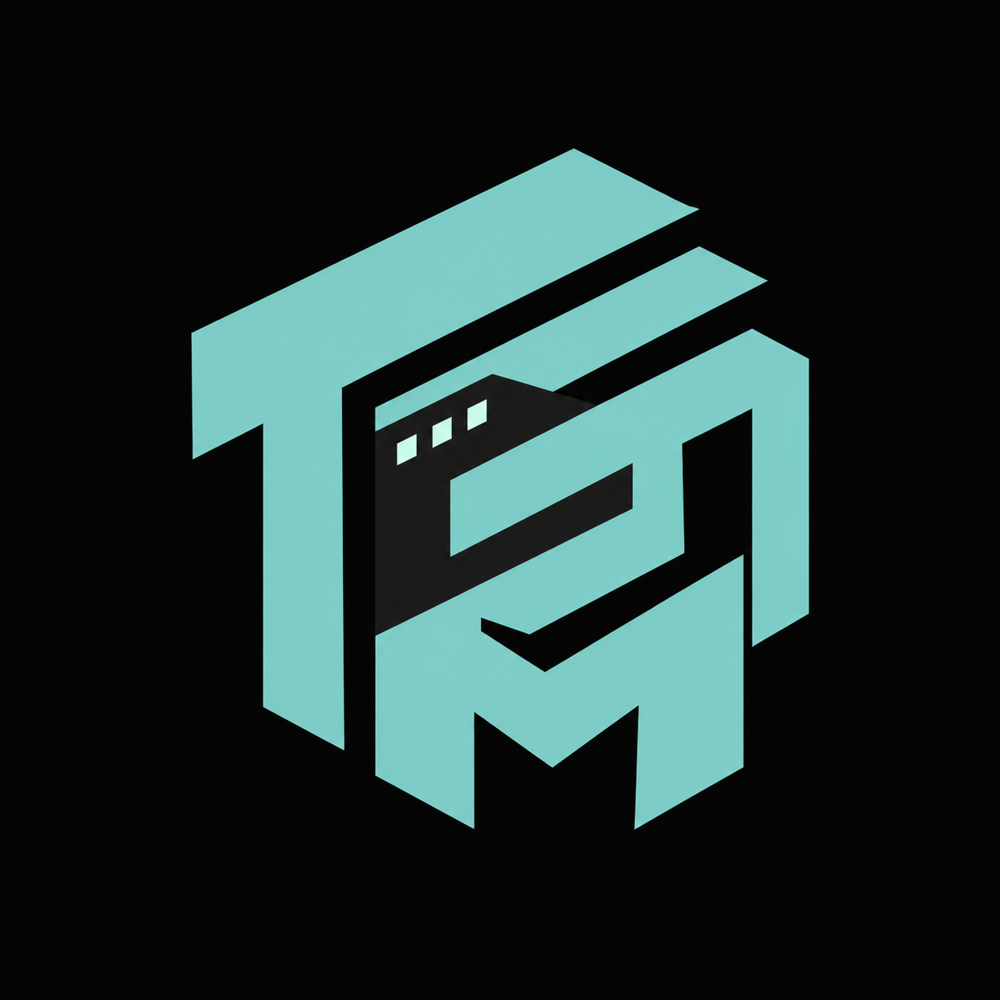

# TBM Theme

<p align="center">
  
</p>

<p align="center">
  <strong>An authentic, update-proof, high-contrast dark theme with uniform surfaces, outline UI glyphs, and calm file icons for Antigravity IDE and VS Code.</strong>
</p>

<p align="center">
  <a href="https://github.com/amanAkhter"></a>
  
  
  
  
  
</p>

---

## 1. Overview & Philosophy

**TBM Theme** was designed by **[Aman Akhter](https://github.com/amanAkhter)** to minimize cognitive fatigue during prolonged engineering sessions. Most modern dark themes suffer from contrasting panels, default fallback borders, and disjointed grey tones between the sidebar, editor, and terminal.

TBM Theme solves this by enforcing **complete surface uniformity**:
1. **Uniform Plane Architecture**: Every single background surface—editor, gutter, tabs, sidebar, terminal, status bar, minimap, and panel—shares an identical dark base (`#0A0A0A`).
2. **Zero-Seam Structural Borders**: Borders between UI regions are unified to the surface color (`#0A0A0A`), eliminating visual gridlines and distractions.
3. **Focal Accents**: High-priority interactive states (active tab indicator, active activity bar item, terminal tab indicator, badges) pop cleanly in electric teal (`#80CBC4`).
4. **100% Declarative & Offline**: Built with zero JavaScript runtime dependencies (`0 JS files`). It carries no licensing engines, telemetry, or network daemons.
5. **Antigravity IDE Update Resilience**: Includes an integrated AST diagnostic tool (`scripts/doctor.mjs`) that inspects the host editor's internal bundle on every update to guarantee zero breaking changes.

---

## 2. Component Suite

| Component | Identifier | Details |
|---|---|---|
| **Color Theme (Default)** | `TBM Theme` | 294 colors, `#0A0A0A` uniform base, `#80CBC4` teal accents |
| **Color Theme (Burgundy)**| `TBM Burgundy` | 294 colors, `#160509` iPhone Pro dark titanium wine base, `#FF7597` rose accents |
| **Color Theme (High Contrast)**| `TBM Theme High Contrast` | Pure `#000000` pitch base, high-contrast syntax highlighting |
| **Product Icon Theme** | `TBM Outline` (`tbm-outline`) | 183 fine outline UI glyphs powered by bundled WOFF2 font |
| **File Icon Theme** | `TBM Icons` (`tbm-icons`) | 393 file & folder definitions with authentic carbon SVGs |

---

## 3. Design Token Architecture & Color Math

### 3.1 Core Palette (TBM Theme & TBM Burgundy)
| Token | TBM Theme | TBM Burgundy | Purpose |
|---|---|---|---|
| `surface.base` | `#0A0A0A` | `#160509` | Unified background for editor, sidebar, tabs, terminal |
| `surface.border`| `#0A0A0A` | `#160509` | Seamless border plane between all editor groups |
| `text.primary` | `#D9D9D9` | `#F5E8EB` | High-legibility primary text & syntax foreground |
| `text.muted` | `#56575D` | `#9E6E78` | Dimmed inactive headers, line numbers, and breadcrumbs |
| `accent.primary`| `#80CBC4` | `#FF7597` | Focal indicators, active borders, and badges |

### 3.2 WCAG Contrast Compliance
- **TBM Theme**: $CR = \frac{0.6868 + 0.05}{0.0031 + 0.05} = \mathbf{14.03 : 1}$ (WCAG AAA)
- **TBM Burgundy**: $CR = \frac{0.7853 + 0.05}{0.0059 + 0.05} = \mathbf{15.19 : 1}$ (WCAG AAA)

- **WCAG Level AA Threshold**: $\ge 4.5:1$
- **WCAG Level AAA Threshold**: $\ge 7.0:1$
- **TBM Theme Performance**: Both variants exceed WCAG AAA requirements by over 100%.
- **WCAG Level AAA Threshold**: $\ge 7.0:1$
- **TBM Theme Result**: **14.03:1 (Exceeds WCAG AAA by 100%)**

---

## 4. Quickstart & Installation

### Option A: One-Command Automated Install (CLI)
From the project workspace root:
```bash
npm run install
```
This automated workflow:
1. Compiles the theme files (`npm run build`).
2. Validates contrast math, font glyphs, and SVG paths (`npm run validate`).
3. Packages the extension into `tbm-theme-2026.9.6.vsix`.
4. Installs the extension into Antigravity IDE via `agy-ide --install-extension`.

### Option B: Manual Installation (GUI)
1. In Antigravity IDE, press `Cmd+Shift+P` (macOS) or `Ctrl+Shift+P` (Linux/Windows).
2. Select **Extensions: Install from VSIX...**.
3. Choose `tbm-theme-2026.9.6.vsix`.

---

## 5. Setting Configuration & Pinning

To pin the entire TBM Theme suite automatically to your user settings:

```bash
# Step 1: Preview proposed changes (Dry run)
npm run apply-settings

# Step 2: Apply to Antigravity settings.json (with automatic safety backup)
node scripts/apply-settings.mjs --apply
```

This ensures your user `settings.json` activates:
```json
{
  "workbench.colorTheme": "TBM Theme",
  "workbench.productIconTheme": "tbm-outline",
  "workbench.iconTheme": "tbm-icons"
}
```

Then reload Antigravity IDE:
`Cmd+Shift+P` → **Developer: Reload Window**.

---

## 6. Antigravity IDE Update Resilience Routine

Whenever Antigravity IDE receives a software update:

```bash
# 1. Run the AST compatibility audit against the installed editor:
npm run doctor

# 2. Inspect the generated report:
cat doctor-report.md

# 3. If new UI keys were introduced:
npm run build && npm run validate

# 4. Re-package and install:
npm run package
agy-ide --install-extension tbm-theme-2026.9.6.vsix --force
```

---

## 7. Project Layout

```
.
├── package.json                   # Declarative extension manifest
├── logo.png                       # Extension icon
├── LICENSE                        # MIT License
├── README.md                      # Comprehensive user documentation
├── CHANGELOG.md                   # KeepAChangelog release ledger
├── doctor-report.md               # AST compatibility report
├── .last-good-version             # Last verified host editor version
│
├── .github/
│   └── workflows/
│       └── ci.yml                 # CI test & validation pipeline
│
├── src/
│   ├── palette.json               # Canonical design token palette
│   ├── workbench-map.json         # Workbench UI semantic mapping
│   ├── tokens-map.json            # Syntax highlighting scopes
│   └── known-product-icon-ids.json# 653 product icon IDs extracted from editor bundle
│
├── themes/
│   ├── tbm-theme.json             # 294 compiled colors: uniform #0A0A0A surfaces & borders
│   ├── tbm-burgundy.json          # 294 compiled colors: uniform #160509 dark wine base, rose accents
│   └── tbm-theme-hc.json          # High-contrast pitch black variant (#000000)
│
├── fonts/
│   └── vira-ui-icons-outline.woff2# Authentic outline WOFF2 font (15.65 KB)
│
├── icons/
│   ├── product-icon-theme.json    # 183 outline product icon glyph definitions
│   ├── file-icon-theme.json       # 393 file & folder definitions
│   ├── files/                     # 271 authentic file SVGs
│   └── folders/                   # Authentic filled & outlined folder SVGs
│
├── scripts/
│   ├── build-tbm.mjs              # Deterministic theme compiler
│   ├── validate.mjs               # WCAG contrast, font, and asset test suite
│   ├── doctor.mjs                 # AST bundle scanner against Antigravity IDE
│   ├── install.mjs                # Full build -> package -> install pipeline
│   └── apply-settings.mjs         # Safe JSONC settings manager with automatic backup
│
├── samples/                       # 10-language syntax verification corpus
│   ├── sample.ts, sample.py, sample.rs, sample.go, sample.json,
│   └── sample.md, sample.html, sample.css, sample.sh, sample.yaml
│
└── tbm-theme-2026.9.6.vsix        # Standalone VSIX distribution package (5.23 MB)
```

---

## 8. Available Scripts

| Command | Purpose |
|---|---|
| `npm run build` | Compiles TBM Theme and High Contrast variants deterministically |
| `npm run validate` | Runs WCAG contrast verification, font checks, and asset path checks |
| `npm run doctor` | Scans `/Applications/Antigravity IDE.app` bundle for compatibility drifts |
| `npm run package` | Builds standalone `.vsix` distribution without runtime dependencies |
| `npm run install` | Automates build, validation, packaging, and extension installation |
| `npm run apply-settings`| Previews or updates Antigravity user settings with automatic backup |

---

## 9. Author & License

- **Author**: Aman Akhter ([https://github.com/amanAkhter](https://github.com/amanAkhter))
- **Email**: `amanakhter07@gmail.com`
- **License**: [MIT License](./LICENSE)
- **Third-Party Attributions**: See [THIRD_PARTY.md](./THIRD_PARTY.md) for full provenance ledger.
